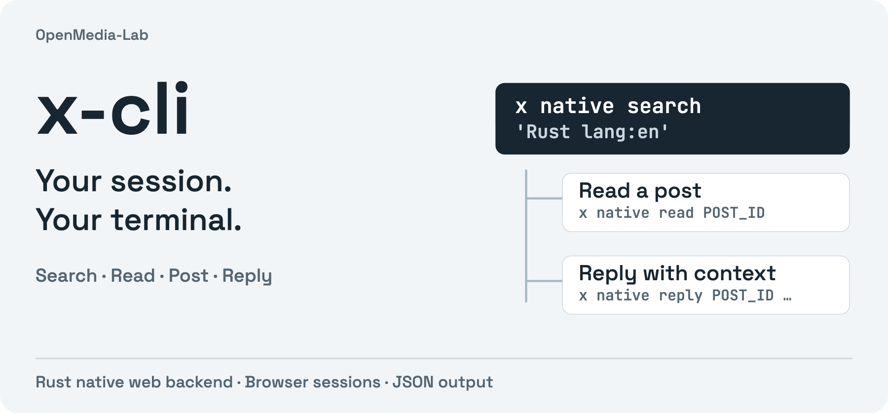

<p align="center"><a href="README.md">English</a> · <strong>简体中文</strong></p>

<p align="center"></p>

# x-cli

**在终端搜索、阅读、发帖和回复 X。** 原生 Rust 接口复用本机浏览器会话，返回 JSON。命令名为 `x`。

[快速开始](#快速开始) · [发帖与回复](#发帖与回复) · [完整命令手册](docs/usage.md) · [English](README.md)

- **带着上下文阅读。** 搜索、主页、时间线，以及 X 接口提供的完整长文内容。
- **串联发布流程。** 文字、最多四张图片、回复与删除；返回的帖子 ID 可用于串联 thread。
- **复用已有登录。** 日常原生命令通过 Rust HTTP 使用浏览器 Cookie，无需 OpenCLI 或浏览器自动化进程。

## 快速开始

需要当前稳定版 Rust 工具链和受支持的桌面浏览器。从源码安装：

```sh
git clone https://github.com/OpenMedia-Lab/x-cli.git
cd x-cli
cargo install --path . --locked

x native login --qr --timeout 180
x native me
x native search 'Rust lang:en' --count 10
```

登录命令复用已验证的浏览器会话，否则在 Chrome 打开 X 官方登录。**扫码使用浏览器与系统的跨设备 Passkey 流程**，需要已登记的 Passkey 和兼容设备；不满足条件时走正常浏览器登录。这不是 X App 扫码授权。详见[登录说明](docs/usage.md#interactive-login-and-passkey-qr)。

支持 Chrome、Brave、Edge、Arc、Vivaldi 和 Chromium 会话。macOS 可能请求钥匙串权限来解密本机 Cookie。原生命令不需要 X 开发者 API 凭据。

## 阅读与翻页

```sh
x native user momoyeyu
x native timeline momoyeyu --count 20
x native read POST_ID
x native search 'Rust lang:en' --count 20 --cursor 'CURSOR_FROM_PREVIOUS_RESULT'
```

搜索和时间线返回 `data` 与 `next_cursor`，非空 cursor 可用于下一页。读取结果包含平台提供的作者、媒体、时间、父回复及互动数据。错误以 JSON 写入 stderr，退出码非零。

## 发帖与回复

**下面的命令会立即公开发布。** 这个接口没有私密或草稿模式。请使用自己的图片，并先检查文案。

```sh
x native post '我做的一个项目：https://example.com' --image cover.png
x native reply POST_ID '补充一些实现细节'
x native delete POST_ID
```

将 `post` 返回的 ID 作为下一条回复的父 ID，即可串联 thread。发帖和回复最多可重复传入四个 `--image`。

## 原生接口与继承接口

| 接口 | 认证方式 | 范围 |
|---|---|---|
| `x native …` | 本机浏览器会话 | 搜索、阅读、账号、时间线、发帖、回复、删除；JSON 输出 |
| 继承的命令 | `~/.xrc` 中的开发者 API 凭据 | [上游命令集](README-UPSTREAM.md) |

原生接口目前不支持编辑帖子、X Articles、上传视频、书签或私信。能读长文本不代表账号有长文发布权限。账号权限和频率限制由 X 决定，未公开的网页接口也可能变化。后端选择与协议细节见[完整手册](docs/usage.md)。

## 参与贡献

提交问题时附上最小复现命令和脱敏错误 JSON，不要附浏览器 Cookie 数据库或凭据。修改代码后运行：

```sh
cargo fmt --all -- --check
cargo test --locked --workspace
cargo clippy --workspace --all-targets -- -D warnings
```

## 一起使用

[postdeck](https://github.com/OpenMedia-Lab/postdeck) 负责文章加工与图卡；平台操作交给独立 CLI： [xhs-cli](https://github.com/OpenMedia-Lab/xhs-cli), [zhihu-cli](https://github.com/OpenMedia-Lab/zhihu-cli), [x-cli](https://github.com/OpenMedia-Lab/x-cli). 更多项目见 [OpenMedia-Lab](https://github.com/OpenMedia-Lab).

## 许可与来源

[MIT](LICENSE.md)。Fork 自 [sferik/x-cli](https://github.com/sferik/x-cli)，保留上游历史、许可和 [legacy 源码](legacy/README.md)。OpenMedia-Lab 维护原生 Rust JSON 与浏览器会话接口。请求事务头推导保留 [twr-tx 归属说明](vendor/twr-tx/NOTICE)。
